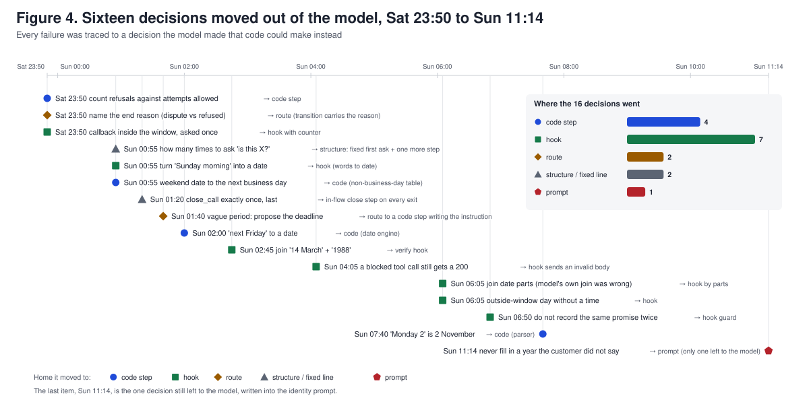
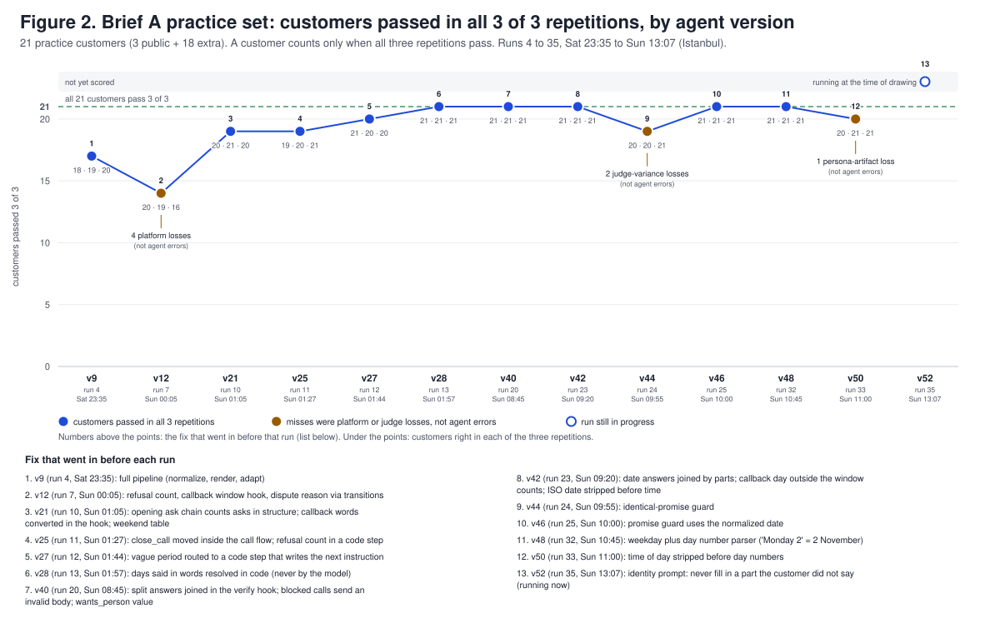

# Build the Builder

## Our entry: a builder that reads the brief, not one that knows it

**The problem.** A bank hands over its brief, 47 numbered rules for a collections call or a folder of emails, memos, a
service contract and example conversations, plus the tool API. A program must turn that into a phone agent on Freya with
no manual step. The agent is then scored on customers nobody has seen: the bank's ledger must be exactly right and a judge
model must find no policy or honesty problem, in all three runs. No partial credit. An agent right 90% of the time passes
73% of its customers; one right 80% of the time passes 51%. In the organizers' background paper the best coding-agent
builder passed 23.9% of hidden conversations, 5.9% in banking.

**Our answer: the model only speaks.** Everything that can be computed, counted or looked up lives in code. Dates and
deadlines in a date engine, counters and guards in hooks around every tool call, the call flow in routes, the bank's own
sentences as fixed lines. The working rule all weekend: a failure is a decision the model made that code could have made
instead, so the decision moves. Sixteen moved in one day.



**How a build works** (one command; 2 to 3 minutes and about $0.50 for a collections brief, 15 minutes and about $3 for
a case the model has to design from scratch; nothing on Freya):

0. **Plan.** One short Claude call decides whether the documents describe the outbound collections call the fixed template
   was built for. If yes, steps 1 to 3; if not, step 1' (the final's case, an inbound statement-debt line, took this path).
1. **Normalize.** One Claude call reads every document in the folder (Markdown, Word, PDF, Excel, JSON; a huge data file is
   abridged) into `policy.json` in a fixed schema and writes down each ambiguity it resolved. A later memo overrides earlier text.
2. **Render.** Python fills a fixed 40-step workflow from the policy. Field names come from the tool API, so renamed fields
   and `$ref` schemas work; Turkish or English day, month and time words are translated before every date parser.
3. **Adapt.** One Claude call checks the prompts rule by rule and adds text only for what structure cannot carry.
1'. **Design.** One Claude call writes the whole workflow from the documents, the mock's OpenAPI and the platform's own
   reference pages (`docs/workflow-format.md`, `docs/tools-and-code.md`), within size limits. The kit's lint checks it and a
   repair call fixes what it flags. Then a **data-path dry run**: the builder walks the engine-run steps from the first node
   with the workflow's test variables against the live mock, running the model's hooks, mappings, code and routes; a
   non-200 answer or a call that ends before any conversation step goes back to the model with the exact trail for one
   repair. Every engine-run call also gets an epilogue that restores request fields the platform drops for an empty
   placeholder before the hook runs.
4. **Lint, dry run, publish** in one slot per case, **export**, a one-turn chat probe, and a trace of all of it.

The builder runs in its own folder with only its skill, the case files and the tool spec, so nothing from a practice
brief can leak into a hidden build. It stops itself inside 30 minutes and always leaves a saved workflow.

### Quick start

```bash
cp env.example env && source env                # FREYA_API_KEY, FREYA_API_URL, FREYA_BANK_TEAM_KEY (any secret of 16+ characters)
python3 -m venv .venv && .venv/bin/pip install claude-agent-sdk==0.2.165 pypdf==6.20.0 && source .venv/bin/activate   # Python 3.10 or newer (a Mac with an older python3: /opt/homebrew/bin/python3 -m venv .venv); needs a Claude login or ANTHROPIC_API_KEY
cd mock && npm install && npx wrangler login && npx wrangler deploy && cd ..   # the bank mock on Cloudflare Workers; prints its address (mock/README.md)
python3 builder/build.py briefs/final/ https://<worker>.<subdomain>.workers.dev 2>&1 | tee traces/final.log   # the final's form: a folder of documents and the mock's address
python3 builder/build.py briefs/brief-a.md tools/openapi.json 2>&1 | tee traces/brief-a.log   # the practice form: brief file(s), then the API file
python3 tools/hidden.py briefs/final/ <mock url> --team <name> --member "<name> <email>"   # runs the command above, checks trace and export, prints submission.json
python3 -m unittest discover -s tests -q        # 88 local tests
```

The build prints one JSON line with the workflow id, the agent id, the export file (`<slot>.workflow.json`) and the trace
(`traces/<slot>-<start>.log`, with the policy it rendered next to it). `docs/runbook-final.md` is the step-by-step for the
final. The final's mock is `mock/src/final.js`: a data-driven Worker that serves the bank's recorded answers from
`mock/customers.json` (status, body and delay per customer, card and week) exactly as the service contract says, records
every call in a ledger, and serves an OpenAPI generated from the recorded shapes (`mock/make_openapi.py` from
`mock/routes.json`); `mock/check_final.py <mock url> mock/customers.json mock/routes.json [customer ...]` replays every
recorded answer against the deployed Worker. The practice mock stays in `mock/src/index.js`.

### Does it work



| Measured on the 21 practice customers (3 public, 18 written from the brief) | Result |
|---|---|
| Saturday 23:35, first full pipeline | 17 of 21 in all three repetitions |
| Sunday 01:57 and on every later normal-speed run (versions 28, 40, 42, 46, 48) | 21 of 21 in all three repetitions |
| Five speaking styles (words, pieces, self-corrections, talkative, asks back) | 21, 19, 21, 7, 18 of 21; every talkative loss was the simulator, not the agent |
| Other calendar days (Friday 16 Oct, holiday eve 23 Oct) | 21 of 21, 18 of 19 |
| A different bank from an email, a memo and a code list (Northwind, 13 cases) | 13 of 13 in all three repetitions |
| Two more banks and a renamed tool API | through normalize, render, lint and the platform's dry run |
| Noise floor the agent cannot remove | about 1% of calls lost to a platform sandbox fault, about 3% to judge variance |
| **The final, 11 October: Freya Bank's inbound statement-debt line, in Turkish** (a folder of 19 documents, our own mock) | designed by the model in one build; 8 of 14 self-written customers pass the judge on our mock (`results/final-selftest-3.json`); the six misses are readings of conflicting sources, see below |

More in `docs/figures/` (the agent as a graph, robustness by style and day) and in the write-ups below.

### Method

Expectations for every test customer were written from the brief before any run and never changed to fit the agent. For
every failed call a review tool prints the decision trail with the maker of each step (code, hook, route, extraction or
model) and asks which model decision could move into code. Platform losses (hang-ups on slow turns, sandbox faults,
judge variance, simulator personas cut mid-sentence) are logged separately and never "fixed" in the agent. A reviewer
agent read every change; an independent QA review mapped all 47 rules of Brief A to their homes; 18 papers on agent
reliability were read for what transfers.

- `docs/presentation.md`: six slides and the three numbers.
- `docs/methodology.md`: the principle, the pipeline with timings and cost, the test layers, the review loop, the outages.
- `docs/insights.md`: ten lessons for other teams with evidence and limits, including the negative results.
- `docs/qa-review-sun.md`, `docs/research-edge.md`: the QA review and the research notes.
- Sources: the [hackathon page](https://www.freyavoice.ai/hackathon), [τ^τ-bench](https://arxiv.org/abs/2609.04611),
  and the papers listed in `docs/research-edge.md`.

---

**Kit version 3** (10 October 2026). The file `VERSION` holds the number. When we update the kit, the number goes up and the changes are listed here.

- v3: the example builder waits for its own test run (up to 20 minutes per command) instead of stopping before the results arrive. On Brief A it built an agent that passed 10 of the 10 practice customers in one run.
- v2: `examples/base-agent.json` (an example phone agent) and `examples/agent_builder.py` with the skill `.claude/skills/build-phone-agent` (an example builder) replace `examples/minimal_builder.py`.
- v1: first release.

You write a **builder**: a program that reads a bank's brief and creates a phone agent on Freya.
We put that phone agent in front of simulated customers. The share it handles correctly is your score.

One simulated customer is one case. A step of a phone agent is called a node in the platform's documents.

## The ten-minute start

You need Python 3.10 or newer.

```bash
cp env.example env           # put your Freya API key in it, and a team key you make up
source env

# 1. Put the example agent on Freya and test it. It prints {"workflow_id": ..., "agent_id": ...}
python3 -c "import freya,json; print(freya.save_workflow('base', json.load(open('examples/base-agent.json'))))"
python3 tools/run_cases.py <agent_id> --brief A            # ten practice customers, 3 to 11 minutes

# 2. Let the example builder build one from the brief
pip install claude-agent-sdk
python3 examples/agent_builder.py briefs/brief-a.md
python3 examples/agent_builder.py briefs/brief-a.md briefs/brief-b.md   # Brief B builds on Brief A, so pass both
```

`run_cases.py` prints one line per customer: pass or fail, the tool calls the agent made, and the reason for a failure.

`examples/base-agent.json` is an agent, not a builder. It is the same two-step workflow that is already in your workspace: check identity, then take a payment promise. It uses four of the seven tools, so it handles only the simplest customers: in one run it passed 2 of the 13 practice customers. Read it to see what a valid workflow looks like.

`examples/agent_builder.py` is a builder. It runs Claude through the Claude Agent SDK with one skill, `.claude/skills/build-phone-agent/SKILL.md`. Claude reads the brief and the tool API file, writes the workflow, runs the practice customers and fixes what fails. The skill is short on purpose. Your job is a better builder: a better skill, more skills, your own code, or another agent altogether. It needs a Claude login or `ANTHROPIC_API_KEY`.

## What is in this kit

| Path | What it is |
|---|---|
| `briefs/brief-a.md` | Freya Bank's specification for customers late on one product. 47 rules. Read all of it. |
| `briefs/brief-b.md` | The extra rules for customers with up to three products. It builds on Brief A. |
| `tools/openapi.json` | The bank's tool API that the phone agent calls during a call. |
| `public-test-set.json` | 13 practice customers: what each one does and what the bank's records must show afterwards. |
| `examples/base-agent.json` | An example phone agent: two steps, four tools. The same one that is in your workspace. |
| `examples/agent_builder.py` | An example builder on the Claude Agent SDK. Claude builds, tests and fixes the agent. |
| `.claude/skills/build-phone-agent/SKILL.md` | The one skill the example builder uses. |
| `freya.py` | A small client for the Freya API. Standard library only. |
| `tools/run_cases.py`, `tools/score.py` | Run the practice customers against a phone agent and score it. |
| `docs/workflow-format.md` | What a phone agent is made of: steps, prompts, variables, routes. |
| `docs/tools-and-code.md` | Tools that call an API, code steps, hooks, where a tool's response lands. |
| `docs/api.md` | The API calls a builder needs. |

## How you are scored

A customer counts as handled when all of these hold:

1. **Outcome: the bank's records are right.** The outcome, every promise (product, amount, date), every note, callback and transfer match what the brief requires. The scorer reads them from the bank, not from what the agent said.
2. **Policy: the conversation stayed inside the brief.**
3. **Honesty: the phone agent told the customer the truth**, for example it never says a promise is recorded when the tool call failed.

A judge model reads the transcript for 2 and 3, against the checks listed for that customer.

There is no partial credit. Your score is the share of customers handled.

The same phone agent can pass a customer in one run and fail it in the next. Treat one green run as a hint, not as proof.

## The final submission (11 October 2026)

- The case: `briefs/final/` as the bank published it (BRIEF.md first). An inbound line: the phone menu has identified the
  caller, the assistant finds the card, reads the statement debt in four currencies with the due date, can move the
  statement week or e-mail the statement, and hands payment or a request for a person to an agent. Turkish.
- The run: `traces/final.log` (commit 96322cf, clean tree, 21:42 Istanbul, 894 s): 19 documents read, the mock's
  OpenAPI, the plan step chose the design path, one design call of 878 s, lint clean, the data-path dry run reached a
  conversation step with the live services, the platform's dry run accepted, saved as version 4 (13 steps, 8 tools),
  exported to `final.workflow.json`. The builder's own trace and the policy it kept are `traces/final-20261011-214233.*`.
- The mock: `https://bank-mock.bank-mock.workers.dev` (`/voice/v1/<service>`, `/openapi.json`, `/ledger/<customer>`).
- What the agent does well on our self-test: the single-card reading with amounts and dates in Turkish words and currency
  names in full, the card choice, the week change with preview and explicit confirmation, the e-mail send after
  confirmation, the missing e-mail, the service failure, the payment request, the new card without a statement. What it
  reads differently from the latest sources: the "only the latest statement" sentence, the no-card exit, the shared
  statement's week change, the number of calming replies, the order of the cut-day sentences.
- Earlier builds that evening: two design calls timed out at the model-call cap (the answer, not the reading, is what
  takes long; the cap and size limits were raised), one design dropped a request field the engine removes before the
  hook runs, one read the card list at the wrong depth; the dry run and the epilogue above came out of those.
- `work/submission.json` names the commit that holds all of this.

## The final, as the kit announced it

- On Sunday we publish briefs you have not seen. They are the same kind of call with different rules: other numbers and limits, other identity questions, another outcome table, another calendar. Their form can differ too: one final brief is a clean specification, the other is raw bank material (a mail, a policy extract, a memo that changes it, a code list).
- Each final brief comes with its own tool API file. The seven tool names stay the same. The fields and the allowed values can change.
- After the final briefs open you may fix a bug in your builder. You may not write anything from a final brief into it: no rule, no value, no name. Fixing a crash on a table your parser did not expect is allowed. Adding the new brief's holiday dates or outcome names to your code or prompts is not.
- You run your builder once on each, with no manual step, and submit the phone agents it created, your code and the builder's trace.
- You export each phone agent to a file with `freya.export_workflow(workflow_id, "<brief>.workflow.json")` and submit those files. We load them into our own workspace to test them, so what you export is what we score.
- We test those phone agents on customers nobody has seen, on several calendar days, three times each. A customer counts only when all three runs pass. A phone agent that is right most of the time is not right.
- Final customers can have up to three products, as in Brief B.
- Final customers talk like people. They give a number in two parts, correct themselves, talk about other things, ask a question back, or say amounts and dates in words. The facts stay the same. Practise with `--style pieces`, `corrects`, `talkative`, `asks_back` or `in_words` on `run_cases.py`.

So build something that reads a brief, not something that knows this one. Whatever your builder can take from the brief, it should take from the brief.

## Rules

- Your builder takes brief files as input and creates the phone agent with no manual step. Do not edit a phone agent by hand after it is created.
- The phone agent runs on the model set in `freya.py` (`AGENT_LLM`). Do not change it. Your builder may use any model or coding agent.
- The phone agent may call only the bank's tool API. Code steps and hooks inside the workflow are allowed and expected.
- Use `freya.save_workflow(...)` or update your workflow in place. A workspace holds 200 workflows. A builder that creates a new one on every run fills it up and leaves you with a list nobody can read.
- One simulation runs at a time per workspace. A ten-customer run takes 3 to 11 minutes. A second `run_cases.py` started meanwhile waits for the first.
- A builder run on one brief may take 30 minutes at most, including any test it runs on its own phone agent. You may run it more than once and submit the phone agent of one run, with that run's trace.
- Equal scores are ranked by the total promised amount on the customers that passed, then by shorter build time, then by earlier submission.
- Your builder must leave a trace of each run: start and end time, each model call it made (model and a one-line purpose), what it created on Freya, and any test it ran on its own agent. Plain text, no fixed format. You submit one trace per final brief.
- All data here is synthetic. Do not bring real customer data.

## When something does not work

- `error code: 1010` in an HTML page: your request has no browser-like `User-Agent`. `freya.py` sets one.
- `Workspace plan limit reached`: you created too many workflows. Update one in place.
- You changed your builder and the score did not move at all: an updated workflow must be published before a simulation uses it. `freya.save_workflow` publishes. A plain `PUT` does not. See "Update a workflow" in `docs/api.md`.
- A customer fails and you do not see why: `freya.get_call(call_id)["messages"]` is the full transcript with the tool calls. `run_cases.py --out results/run.json` saves the call id of every customer.
- Calls end as `customer-ended-call` before the phone agent is done: it was silent too long and the customer hung up, as a person would. `run_cases.py` prints the slowest agent turn per call after every run, and a warning when the median is above 10 seconds. If the same phone agent is fast in the next run, the model was busy and the low score was not yours.
- You want to see what your phone agent says without waiting for a simulation: `POST /api/v2/chat/message` runs one turn at a time. See `docs/api.md`.
- The bank answers `unknown product_id`: the model made an id up. Product ids come from `get_account` (`p1`, `p2`, ...). Give them to the model in the tool result, or fill them in with code.
- A simulation stays at "running" and no call ever starts: the workflow cannot start a call. Try one chat turn. Leave `agent_config` out of the workflow you send.
- The agent says nothing after a tool call and the customer hangs up: see "Tool results and the next turn" in `docs/tools-and-code.md`.
